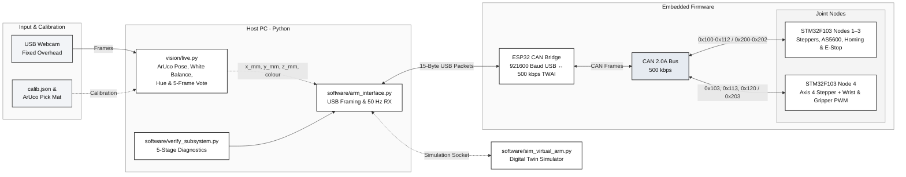

# 6-Axis Color-Sorting Robotic Arm (Distributed CAN Architecture)

## Overview

Control firmware, computer vision, and Host PC Python stack for a 6-DOF color-sorting manipulator. Instead of centralized point-to-point controller wiring and arm-mounted sensors, the system combines an overhead USB webcam pipeline with a distributed `500 kbps` CAN bus linking four `STM32F103` joint nodes (`RoboticArmPCB` Rev E) to the Host PC through an `ESP32` USB-to-CAN bridge.

### Repository Structure

```text
├── firmware/
│   ├── esp32_can_bridge/
│   │   └── esp32_can_bridge.ino   # Standalone USB (921600 baud) <-> CAN (500 kbps) bridge
│   └── stm32_joint_node/
│       └── joint_node_fw.ino      # Standalone firmware for all 4 STM32 joint PCBs
├── vision/
│   ├── README.md                  # Camera setup, calibration, usage, coordinate frame
│   ├── detector.py                # One-frame cube colour + position detection (OpenCV)
│   ├── mat.py                     # Printable pick mat (ArUco markers + grey colour reference)
│   ├── calibrate.py               # Lens and colour calibration tool
│   ├── live.py                    # `Vision` class for motion code + live viewer
│   └── docs/                      # Simulated test report, design book section 6
├── software/
│   ├── requirements.txt           # Python dependencies (pyserial)
│   ├── arm_interface.py           # Low-level USB-CAN driver & 50 Hz telemetry listener
│   ├── sim_virtual_arm.py         # Digital twin simulator (ESP32 + 4x STM32 nodes)
│   └── verify_subsystem.py        # Automated 5-stage subsystem verification suite
└── simulation/                    # Gazebo (ROS 2 Humble) sim from the SolidWorks URDF, see simulation/README.md
    ├── src/                       # description, gazebo world, control (homing, IK, pick-and-place, E-stop), analysis
    ├── sim_evidence/              # Figures, torque table, results.json for design book Section 4
    └── docs/                      # Technical notes: URDF fixes, assumptions, test status
```

---

## Architecture

### System Data Flow



### Communication Protocols

* **USB Serial Framing (Host PC ↔ ESP32):** `921,600` baud, fixed 15-byte binary frames (`[0xAA, 0x55, ID_H, ID_L, DLC, D0..D7, XOR_CSUM, 0x0A]`).
* **CAN 2.0A Frame Map (`500 kbps`, 11-bit Standard IDs):**

| CAN ID | Direction | Payload (8 Bytes) | Function |
| :--- | :--- | :--- | :--- |
| `0x100` – `0x103` | PC → Node `0..3` | `int32 target_cdeg`, `uint16 speed_dps`, `uint16 flags` | Move Axis `1..4` to target angle (`0.01°` units) |
| `0x110` – `0x113` | PC → Node `0..3` | `uint8 cmd` (`1`=Home, `2`=Enable, `3`=Disable, `4`=Zero) | Joint state & homing commands |
| `0x120` | PC → Node `3` | `uint16 wrist1_us`, `uint16 wrist2_us`, `uint16 grip_us` | `50 Hz` servo PWM (`500–2500 µs`) on Node 4 |
| `0x200` – `0x203` | Node `0..3` → PC | `int32 actual_cdeg`, `uint8 status`, `uint8 estop_ok`, `uint16 err` | `50 Hz` `AS5600` encoder & E-stop telemetry |

---

## Wiring and Pinout

### 1. ESP32 USB-to-CAN Bridge (`SN65HVD230` Transceiver)

| ESP32 Pin | Transceiver / Bus Signal | Notes |
| :--- | :--- | :--- |
| `GPIO 5` | `CAN_TX` (`TXD`) | Internal TWAI controller TX |
| `GPIO 4` | `CAN_RX` (`RXD`) | Internal TWAI controller RX |
| `3.3V` / `GND` | `VCC` / `GND` | Tie transceiver `GND` to the CAN trunk `GND` |
| `CAN_H` / `CAN_L` | CAN Trunk | Place a **`120 Ω` termination resistor** across `CAN_H` and `CAN_L` at the bridge |

### 2. STM32F103 Joint Node (`RoboticArmPCB` Rev E)

| STM32 Pin | Peripheral / Signal | Function |
| :--- | :--- | :--- |
| `PA11` / `PA12` | `CAN1_RX` / `CAN1_TX` | `500 kbps` bare-metal `bxCAN` (`SN65HVD230`) |
| `PB8` / `PB9` / `PB5` | `STEP` / `DIR` / `DRV_EN` | `TMC2209` stepper driver control (`DRV_EN` gated by hardware E-stop) |
| `PB10` / `PB11` | `I2C2_SCL` / `I2C2_SDA` | `AS5600` 12-bit magnetic shaft encoder (`0x36`) |
| `PB0` | `HOME_SW` | `KW4` mechanical homing limit switch (active-low, internal pull-up) |
| `PA1` | `ESTOP_SENSE` | Analog sense (`100 kΩ / 8.2 kΩ` divider from `ESTOP_24V`, `1.82 V` nominal) |
| `PB12` / `PB13` / `PB14` | `JP1` / `JP2` / `JP3` | Binary node address jumpers (active-low to `GND`) |
| `PB6` / `PB7` / `PA8` | `SERVO_1` / `SERVO_2` / `SERVO_3` | **Node 4 only:** Wrist 1, Wrist 2 (`2× 20 kg·cm`), and Gripper PWM (powered via `XL4015E1` `24 V → ~6 V` buck) |

### 3. Node Addressing & Termination Jumpers (`JP1–JP4`)

| Axis | Node ID | `JP3` (`PB14`) | `JP2` (`PB13`) | `JP1` (`PB12`) | `JP4` (`120 Ω` CAN Term) | Command / Telemetry IDs |
| :--- | :---: | :---: | :---: | :---: | :---: | :--- |
| **Axis 1 (Base)** | `0` | Open | Open | Open | Open | `0x100` / `0x110` / `0x200` |
| **Axis 2 (Shoulder)** | `1` | Open | Open | **Closed** | Open | `0x101` / `0x111` / `0x201` |
| **Axis 3 (Elbow)** | `2` | Open | **Closed** | Open | Open | `0x102` / `0x112` / `0x202` |
| **Axis 4 (Wrist + Servos)** | `3` | Open | **Closed** | **Closed** | **Closed** | `0x103` / `0x113` / `0x120` / `0x203` |

---

## How to Build and Run

### 1. Compile and Flash Firmware

1. **ESP32 Bridge (`firmware/esp32_can_bridge/esp32_can_bridge.ino`):**
   * Select board **`ESP32 Dev Module`**, upload speed **`921600`**, and flash via USB.
2. **STM32 Joint Nodes (`firmware/stm32_joint_node/joint_node_fw.ino`):**
   * Install the **STM32 MCU based boards** core in Arduino IDE (`https://github.com/stm32duino/BoardManagerFiles/raw/main/package_stmicroelectronics_index.json`).
   * Select **`Generic STM32F1 series`** → **`BluePill F103C8`**.
   * Set **USB support** to **`None`** *(required so `PA11` and `PA12` remain dedicated to `CAN1`)* and **Upload method** to **`STM32CubeProgrammer (SWD)`**.
   * Flash the same binary onto all four joint PCBs via ST-Link V2.

### 2. Run in Simulation Mode (No Hardware Required)

1. Install the control stack dependency:
   ```bash
   cd software
   pip install -r requirements.txt
   ```
2. Start the virtual arm simulator in **Terminal 1** (type `e` + `Enter` at any time to simulate tripping the hardware E-stop):
   ```bash
   python sim_virtual_arm.py
   ```
3. Run the automated 5-stage verification suite in **Terminal 2**:
   ```bash
   python verify_subsystem.py
   ```

### 3. Run Computer Vision Setup & Detection

All vision commands run from the **repository root** (`python -m vision...`). See `vision/README.md` for full calibration instructions and coordinate frame definitions.

```bash
pip install -r vision/requirements.txt
python -m vision.mat                                           # Generate A4 pick mat (vision/assets/pick_mat_A4_300dpi.png)
python -m vision.calibrate colours --camera 0 --names red blue # Calibrate red and blue cube hues
python -m vision.live --camera 0                               # Launch live detection viewer
```

**Python Integration:**
```python
from vision.live import Vision

r = Vision(camera=0).read_stable()  # 5-frame majority vote
if r.present and r.colour in ("red", "blue"):
    # Target cube centre in arm base frame (mm): r.x_mm, r.y_mm, r.z_mm
    print(f"Detected {r.colour} cube at ({r.x_mm:.1f}, {r.y_mm:.1f}, {r.z_mm:.1f}) mm")
```

### 4. Switch to Physical Hardware

Once the ESP32 bridge is connected over USB and the 24 V CAN trunk is powered:
* Replace `"socket://127.0.0.1:5555"` with your ESP32 serial port (e.g., `"COM5"` on Windows or `"/dev/ttyUSB0"` on Linux) when instantiating `RoboticArmInterface(port="COM5")`.
